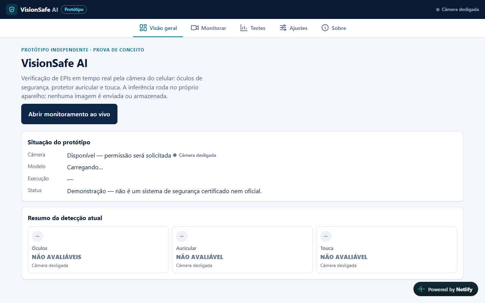

# VisionSafe AI

Prova de conceito de verificação de EPIs pela câmera do celular: **óculos de segurança**, **protetor auricular** e **touca**.

**[Abrir a demonstração](https://visionsafe-ai-demo.netlify.app)**

> Projeto independente, sem vínculo com nenhuma empresa. Não é um sistema certificado e não substitui a supervisão de segurança. Qualquer uso real precisaria de validação por um profissional de segurança do trabalho.



## O que ele faz

- Roda **no próprio aparelho**: nenhuma imagem é enviada ou gravada.
- Mostra três estados por EPI: Detectado, Não confirmado e Não avaliável. "Não confirmado" não prova ausência; quem confere é o técnico.
- Verifica cada pessoa separadamente, em uma janela de tempo.
- Funciona sem internet depois da primeira visita.
- Tem tela de testes com gabarito (precisão, revocação e latência) e exportação em CSV.

## Como funciona

- PWA com React, TypeScript e Vite.
- Inferência com ONNX Runtime Web em Web Worker, usando modelos YOLO11n.
- Testes com Vitest e Playwright.

## Como rodar

```bash
cd web
npm install
npm run dev
```

## Modelos

Os arquivos dos modelos não estão neste repositório porque as licenças dos dados de treino e do YOLO limitam a redistribuição. Sem eles, a interface abre, mas a detecção não funciona. A demonstração publicada é apenas para fins não comerciais.

## Sobre

Criado com apoio de ferramentas de IA.
